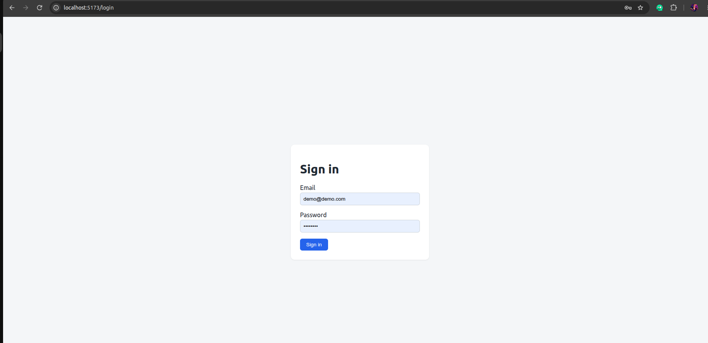
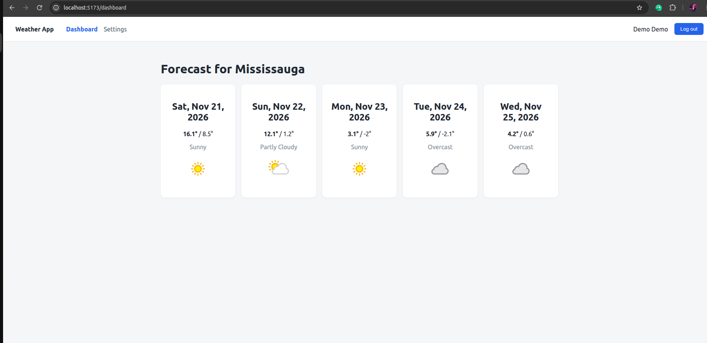
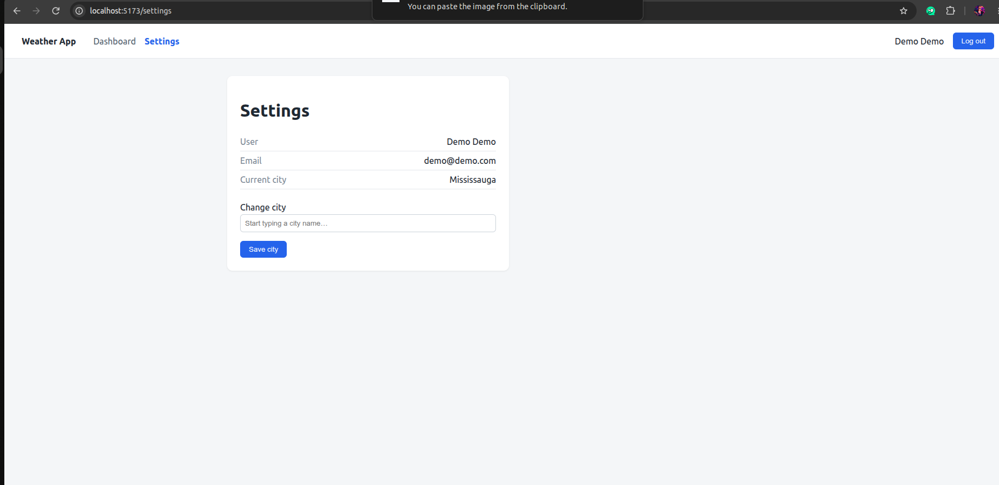

## Weather app
It uses the weatherapi.com API to get the latest forecast for a selected city

### Architecture
- Frontend: React SPA written in TypeScript (built with Vite). It has three screens: 
    - login page, 
    - dashboard with a 5-day forecast for a selected city
    - settings page, the user sets a home city

- Backend: A monolithic Laravel REST API, uses SQLite for storage, authenticates with Laravel Sanctum bearer tokens. The following endpoints are available:
    - POST /api/login
    - POST /api/logout
    - GET /api/user
    - GET /api/city
    - POST /api/city
    - GET /api/city/search

### Screenshots
###
# Login

#### Dashboard

#### Settings

### AI detector checks (PHP and Typescript)
 - https://aicodedetector.org/ : 66% - 68% human written code
 - https://aicodeplag.com/en/ai-code-detector : 68% - 90% AI written code
 - https://codespy.ai/ : 79% human written code
 - https://solvely.ai/app/ai-detector : 71% AI written code